# 💰 친구와 함께 하는 무지출 챌린지, 짠팟 (JJANPOT)


> 팀원들과 함께 절약 목표를 정하고, 매일 지출·무지출을 인증하며 1주일 동안 함께 아껴보는 팀 단위 절약 챌린지 앱입니다.
> 2026년 5월 1일 iOS App Store에 출시해 약 3개월간 실서비스로 운영했으며, 현재는 서비스를 종료했습니다.

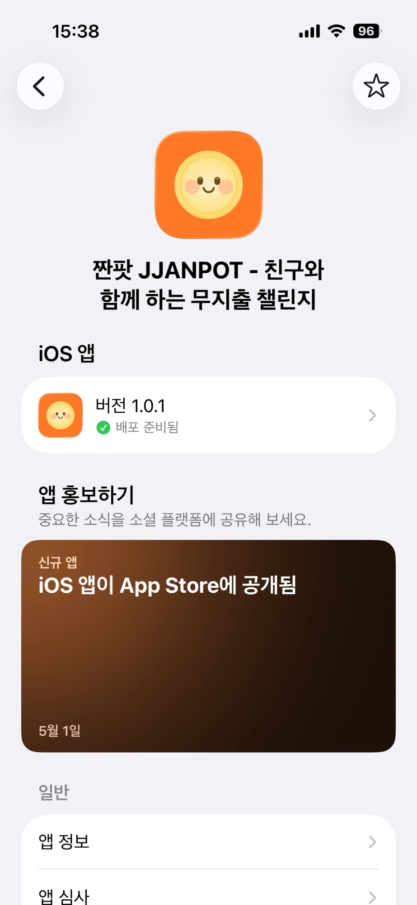

## 🎬 Demo

> 회원가입 → 챌린지 생성 → 초대코드 입력 → 절약 인증 → 결과 리포트까지의 전체 흐름 (약 1분)

https://github.com/user-attachments/assets/19f5a6a2-7830-49c2-a78b-376fa487a82d

## 📱 Screens

| 홈 (진행 중) | 챌린지 만들기 | 카테고리·금액 선택 | 목표 금액 설정 |
|:---:|:---:|:---:|:---:|
| 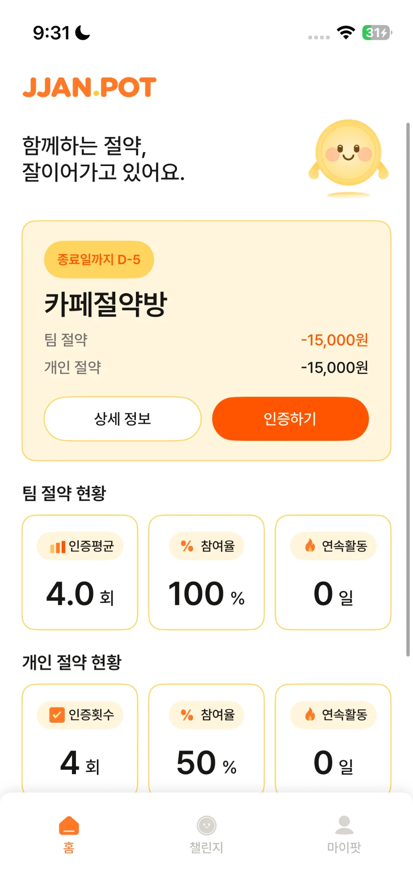 | 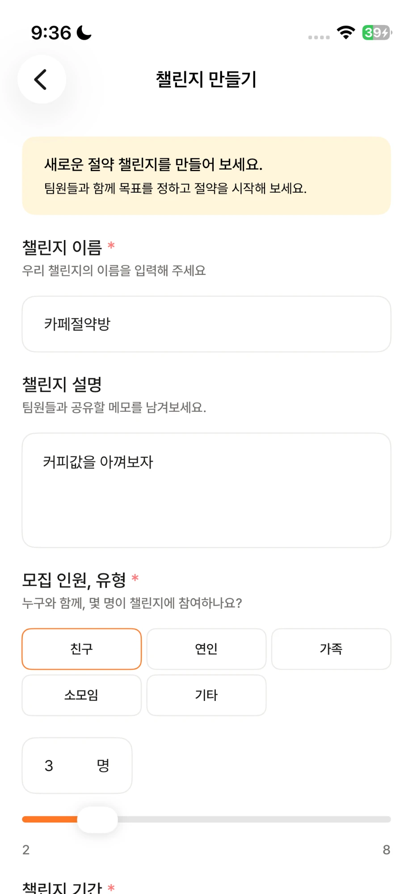 | 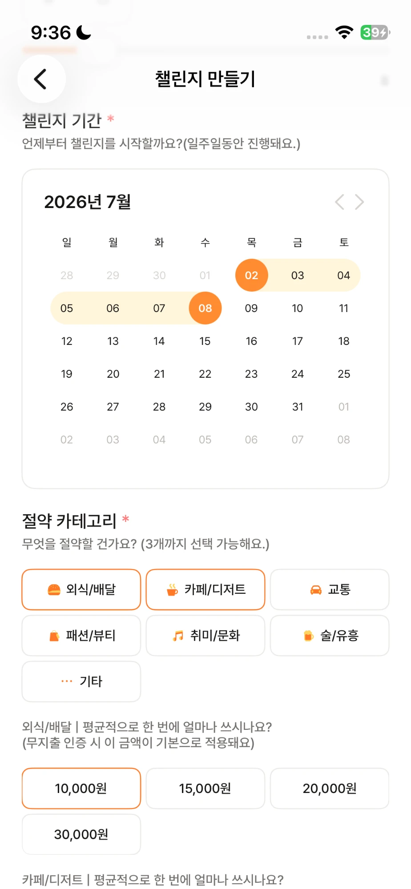 | 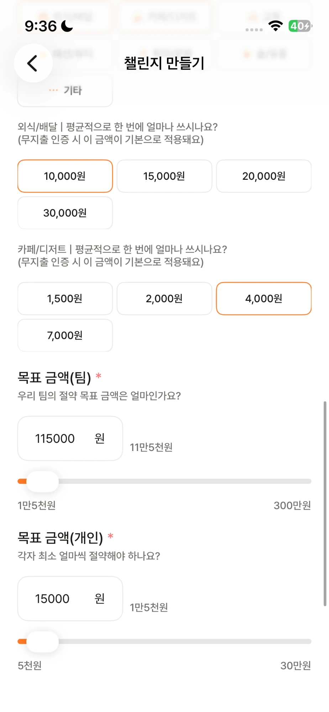 |

| 대기 중인 챌린지 | 초대 코드 | 챌린지 상세 | 절약 금액 가이드 |
|:---:|:---:|:---:|:---:|
| 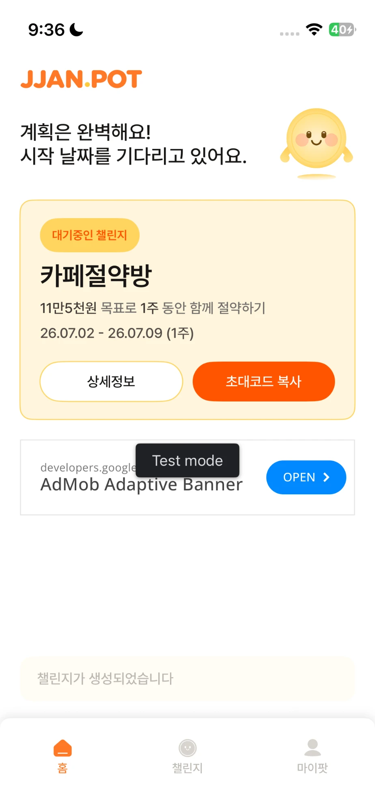 | 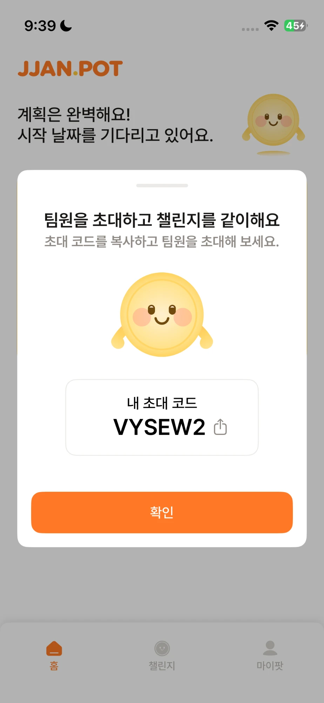 | 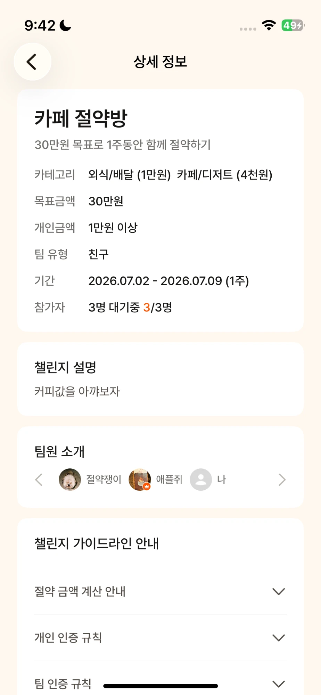 | 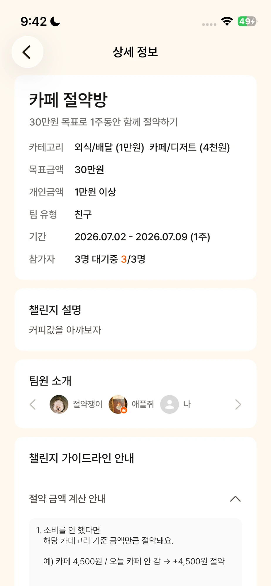 |

| 인증하기 | 인증 후 홈 | 팀 인증 피드 | 팀 인증 피드 |
|:---:|:---:|:---:|:---:|
| 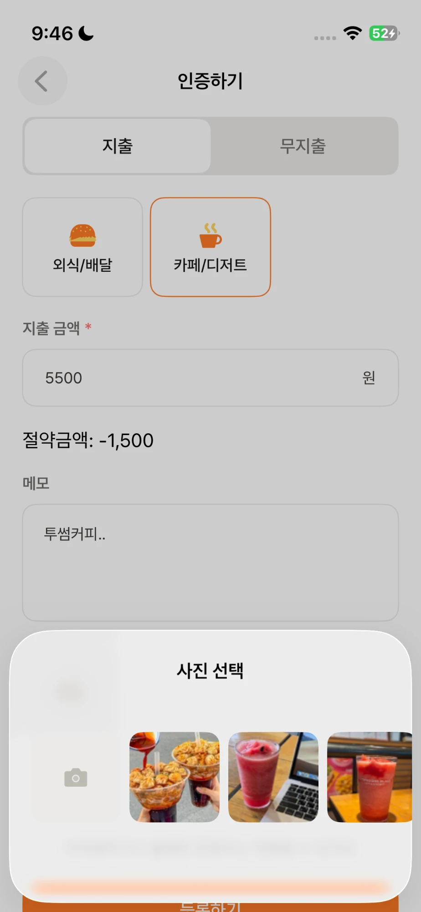 | 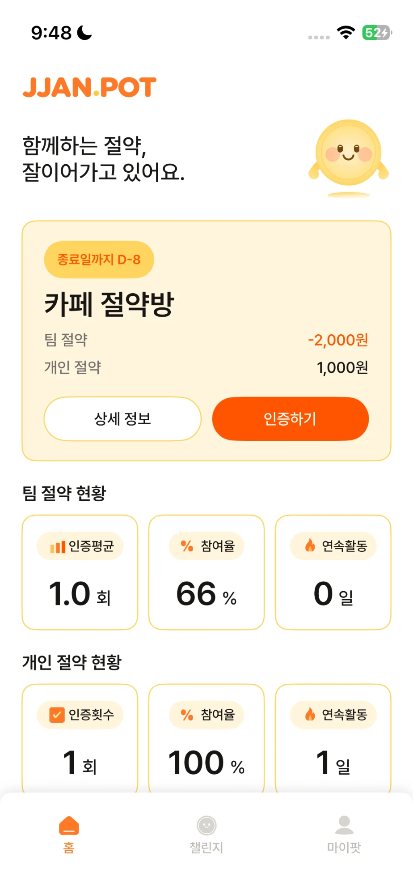 | 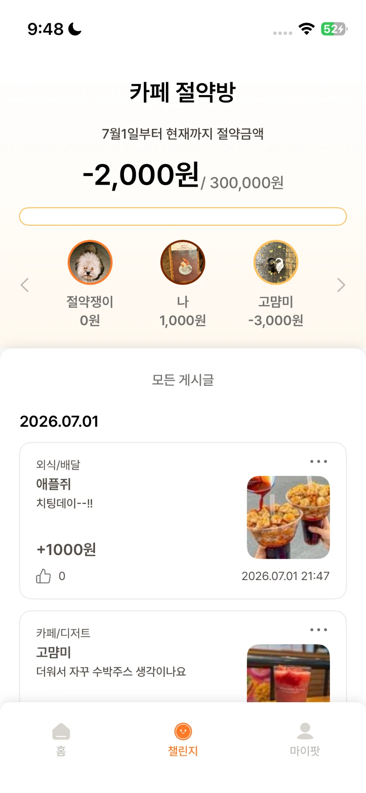 | 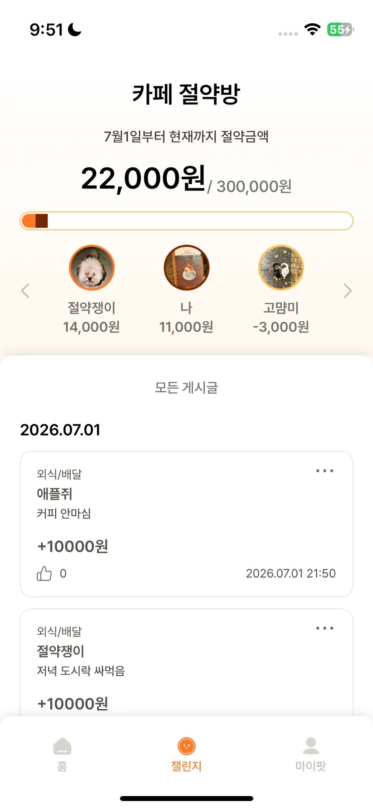 |

| 챌린지 완료 알림 | 결과 리포트 | 푸시 알림 (인증·리마인드) | 푸시 알림 (좋아요) |
|:---:|:---:|:---:|:---:|
| 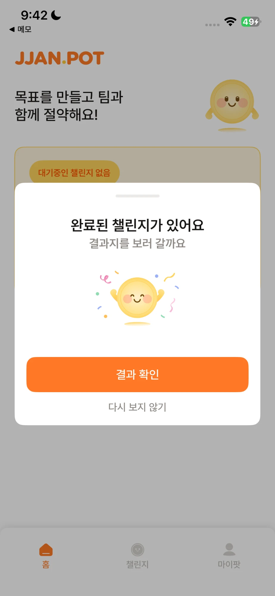 | 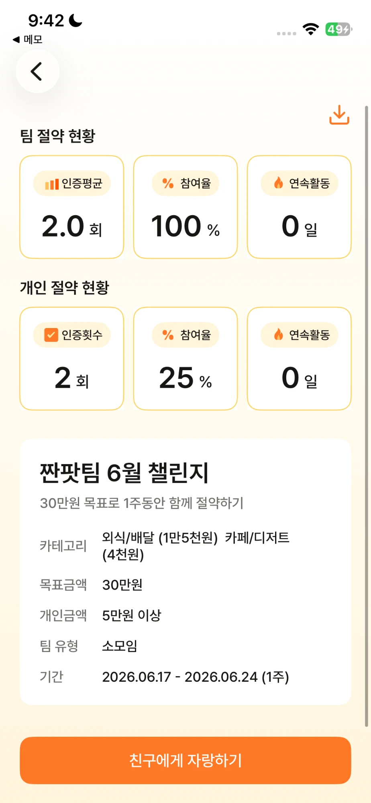 | 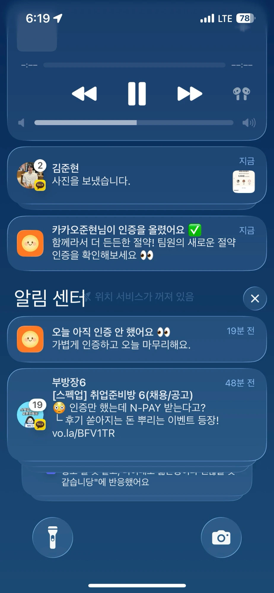 | 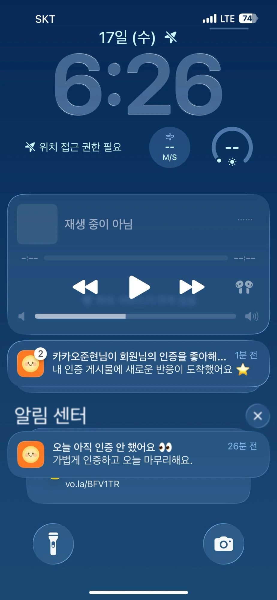 |


## 📊 Service Operation

> 운영 기간: 2026.05.01 ~ 2026.07 (App Store 지표는 7/1 기준, 그 외는 운영 DB 스냅샷 기준이며 팀원 계정 포함)

| 구분 | 지표 |
|---|---|
| App Store 유입 | 노출 약 1,000회 · 제품 페이지 조회 209회 · 다운로드 30건 (최초 24 + 재다운로드 6) |
| 신규 가입 | 17명 (Kakao 13 · Apple 2 · Google 2), 온보딩 완료율 65% (11/17) |
| 챌린지 | 16개 생성 · 15개 시작, 다인원 챌린지 평균 3.1명 참여 |
| 절약 인증 | 78건 (지출 41 · 무지출 37), 메모 작성률 85% · 사진 첨부율 49% |
| 소셜 상호작용 | 인증 좋아요 22건 |
| 앱 업데이트 | 사용자 기기 업데이트 설치 34건 |

**운영 데이터로 확인한 것**
- **리마인드 푸시 시간대에 인증이 몰림:** 인증의 31%(24/78)가 18~19시에 등록되어, 18시 데일리 리마인드 푸시 발송 시간대와 겹칩니다.
- **1인 챌린지 시작 허용 버그:** 팀 최소 인원은 2명이지만 챌린지 시작 시점에는 인원을 검증하지 않아서, 시작된 챌린지 15개 중 5개가 리더 혼자 진행되었습니다. `WAITING → ONGOING` 전환 스케줄러에 참여 인원 검증이 빠진 설계 누락이었습니다.
- **팀 성공 0건:** 출시 후 종료된 챌린지 13개가 모두 실패했습니다. 팀 목표를 126% 달성하고도 개인 최소 금액을 못 채운 팀원 때문에 실패한 사례가 있어서, "개인 최소 금액 AND 팀 목표 금액" 성공 조건이 지나치게 엄격했다고 판단했습니다.

> 상세 분석: [운영 데이터 회고](docs/retrospective-operation-data.md)

## 🛠 Tech Stack

### ☕ Backend
- Java 21
- Spring Boot 3.5.11
- Spring Data JPA (Hibernate)
- Spring Security + JWT (jjwt 0.12.3)
- QueryDSL 5.1.0
- Flyway (DB 마이그레이션)

### 💾 Database
- MySQL 8.0

### ☁️ Infrastructure
- AWS EC2 (Nginx, Spring Boot Blue/Green 컨테이너)
- AWS RDS for MySQL
- AWS S3 (이미지 스토리지, Presigned URL 업로드)
- Nginx (리버스 프록시, 블루그린 upstream 전환)
- Docker

### 🔄 CI/CD
- GitHub Actions
- Docker Hub
- 블루그린 무중단 배포 (`deploy.sh`)
- Discord Webhook (배포 성공/실패 알림)

### 🤖 External Services
- Firebase Cloud Messaging (푸시 알림)
- Kakao / Google / Apple 소셜 로그인

### 📝 Documentation
- SpringDoc OpenAPI 3 (Swagger)

### 🔍 Logging & Code Quality
- Logback + Logstash Encoder (JSON 로그), MDC Trace ID
- Checkstyle (Naver 컨벤션)

### 🧪 Testing
- JUnit 5 + Mockito
- H2 (테스트 DB)

## 🏗 Architecture

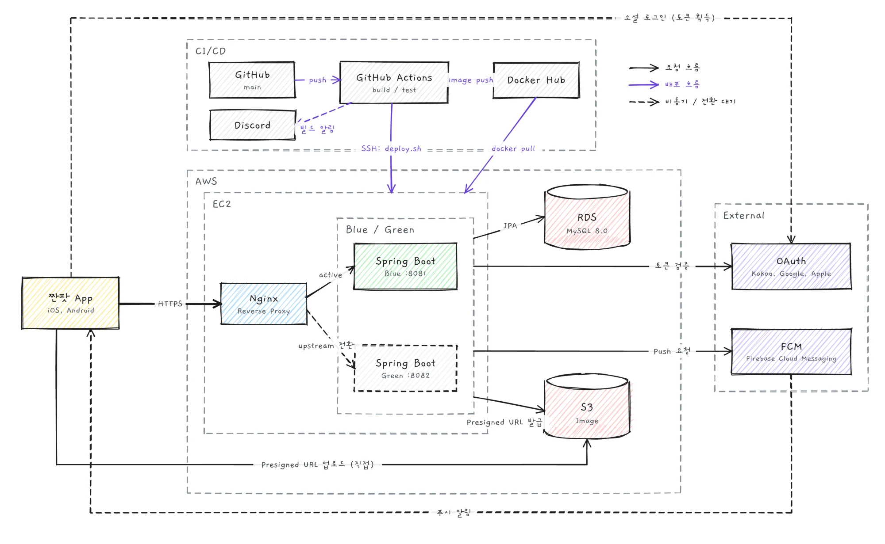

- 사용자는 iOS/Android 앱에서 API를 호출하고, 요청은 EC2의 Nginx를 거쳐 현재 활성화된 Spring 컨테이너(Blue 8081 / Green 8082)로 전달되는 흐름
- `main` 브랜치에 푸시하면 GitHub Actions가 빌드·테스트 후 Docker 이미지를 Docker Hub에 업로드하고, EC2에 SSH 접속해 `deploy.sh`로 배포하는 CI/CD 파이프라인 구조
- 블루그린 배포: 비활성 포트에 새 버전 컨테이너를 띄우고 `GET /health`로 정상 확인 후 Nginx upstream을 전환, 기존 컨테이너를 종료
- 데이터는 RDS(MySQL)에 저장하고, 이미지는 S3에 저장하는 구조 (인증 이미지는 multipart로 서버 경유 업로드, Presigned URL 발급 API도 제공)
- 챌린지 상태 전환과 푸시 알림은 Spring Scheduler로 동작하며, FCM을 통해 앱에 푸시 알림을 발송

## 🗂 ERD

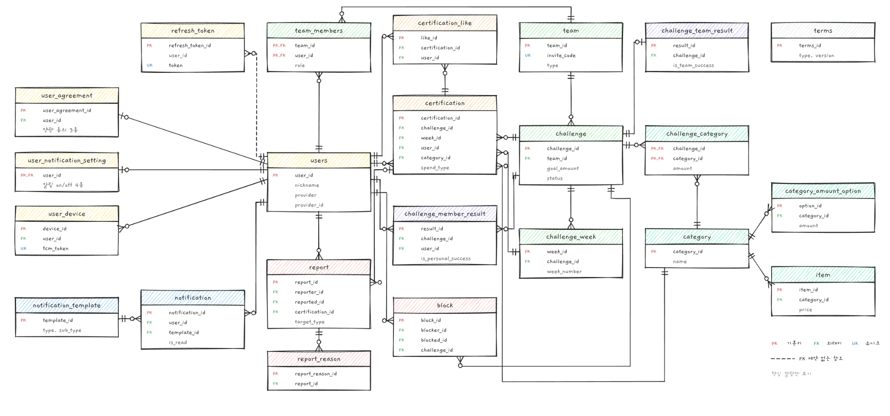

## 🚀 Getting Started

### ✅ Prerequisites

- Java 21
- MySQL 8.0 (로컬 `localhost:3306/jjanpot`)

### ⚙️ Environment Setup

1. 로컬 DB 생성

```sql
CREATE DATABASE jjanpot DEFAULT CHARACTER SET utf8mb4;
```

2. 환경변수 설정

| 환경변수 | 설명 |
|---|---|
| `DB_URL` | DB 접속 URL (`prod` 프로필) |
| `DB_USERNAME` | DB 계정 |
| `DB_PASSWORD` | DB 비밀번호 |
| `JWT_SECRET` | JWT 서명 시크릿 (Access 1시간 / Refresh 30일) |
| `ENCRYPT_KEY` | 개인정보 암호화 키 (AES, Base64) |
| `KAKAO_CLIENT_ID` | 카카오 로그인 REST API 키 |
| `KAKAO_CLIENT_SECRET` | 카카오 로그인 Client Secret |
| `S3_ACCESS_KEY` | AWS IAM Access Key (S3 이미지 업로드, `ap-northeast-2`) |
| `S3_SECRET_KEY` | AWS IAM Secret Key |
| `KEY_PATH` | FCM 서비스 계정 키 파일 경로 |

> 로컬 실행 시에는 `local.env` 와 `src/main/resources/application-local.yml` 을 생성해 주입합니다. 두 파일 모두 `.gitignore` 대상입니다.

3. Spring 애플리케이션 로컬 실행 (기본 프로필: `local`)

```bash
./gradlew bootRun
```

또는

```bash
./gradlew build
java -jar build/libs/server-0.0.1-SNAPSHOT.jar
```

## 📁 Project Structure

도메인 중심의 패키지 구조를 사용합니다.

```
src/main/java/com/jjanpot/server/
├── global/                        # 전역 설정 및 공통 기능
│   ├── config/                   # 설정 클래스 (JPA, QueryDSL, S3, Firebase, Scheduler, CORS)
│   ├── security/                 # SecurityConfig, JWT 필터 및 토큰 프로바이더
│   ├── auth/                     # OAuth 설정 프로퍼티
│   ├── exception/                # BusinessException, ErrorCode, GlobalExceptionHandler
│   ├── aop/                      # Trace ID, 서비스 예외 로깅 Aspect
│   ├── common/                   # 공통 DTO(SuccessResponse), 헬스체크·버전·이미지 컨트롤러
│   ├── infra/storage/            # S3 업로드
│   ├── service/push/             # FCM 푸시 발송
│   ├── annotation/               # 커스텀 어노테이션
│   ├── resolver/                 # 아규먼트 리졸버
│   ├── swagger/                  # Swagger 설정, 어노테이션
│   └── util/                     # 유틸리티
└── domain/                        # 도메인 레이어
    ├── auth/                     # 소셜 로그인, JWT 발급, Refresh 토큰 정리
    ├── user/                     # 프로필, 온보딩, 마이페이지, 알림 설정
    ├── team/                     # 팀, 초대코드, 팀원
    ├── challenge/                # 챌린지 생성·조회·결과, 상태 전환 스케줄러
    ├── certification/            # 절약 인증, 좋아요
    ├── category/                 # 절약 카테고리, 금액 선택지
    ├── item/                     # 절약 금액 환산 물건
    ├── notification/             # FCM 알림, 알림 목록, 푸시 스케줄러
    ├── notification_template/    # 알림 문구 템플릿
    ├── report/                   # 사용자·인증글 신고
    ├── block/                    # 사용자 차단
    └── terms/                    # 약관
```

각 도메인은 아래 구조를 따릅니다:

```
domain/{domain}/
├── controller/              # Controller
│   └── docs/                # Swagger API 명세 인터페이스
├── dto/                     # Request/Response DTO (record)
├── service/                 # 비즈니스 로직
├── entity/                  # JPA 엔티티 및 Enum
├── repository/              # Spring Data JPA Repository (QueryDSL)
└── scheduler/               # 스케줄러 (필요한 도메인만)
```

## 📡 API Endpoints

**인증**

| Method | Path | 설명 |
|--------|------|------|
| POST | `/api/auth/v1/login/{provider}` | 소셜 로그인 (kakao/google/apple) |
| POST | `/api/auth/v1/login/kakao/code` | 카카오 인가 코드 로그인 |
| POST | `/api/auth/v1/refresh` | 토큰 재발급 |
| POST | `/api/auth/v1/logout` | 로그아웃 |

**온보딩**

| Method | Path | 설명 |
|--------|------|------|
| POST | `/api/users/v1/onboarding/profile` | 프로필 생성 |
| POST | `/api/users/v1/onboarding/agreement` | 약관 동의 |
| POST | `/api/users/v1/onboarding/invite-code` | 초대코드 입력 (팀 참여) |

**마이페이지**

| Method | Path | 설명 |
|--------|------|------|
| GET | `/api/users/v1/profile` | 프로필 조회 |
| PUT | `/api/users/v1/profile` | 프로필 수정 |
| GET | `/api/users/v1/challenge-stats` | 챌린지 통계 (총 횟수, 성공률) |
| DELETE | `/api/users/v1/withdraw` | 회원 탈퇴 |
| GET | `/api/users/v1/notifications` | 알림 설정 조회 |
| PATCH | `/api/users/v1/notifications` | 알림 설정 수정 |

**챌린지**

| Method | Path | 설명 |
|--------|------|------|
| POST | `/api/challenges/v1` | 챌린지 생성 |
| POST | `/api/challenges/v1/{id}/cancel` | 챌린지 취소 |
| GET | `/api/challenges/v1/current` | 현재 챌린지 조회 (홈 화면) |
| GET | `/api/challenges/v1/{id}/detail` | 챌린지 상세 조회 |
| GET | `/api/challenges/v1/{id}/members` | 팀원 절약 현황 조회 |
| GET | `/api/challenges/v1/{id}/stats` | 팀/개인 절약 현황 통계 |
| GET | `/api/challenges/v1/{id}/result` | 챌린지 결과 리포트 |
| GET | `/api/challenges/v1/history` | 완료된 챌린지 이력 |

**절약 인증**

| Method | Path | 설명 |
|--------|------|------|
| POST | `/api/certifications/v1` | 인증 생성 (multipart) |
| PUT | `/api/certifications/v1/{certificationId}` | 인증 수정 (multipart) |
| DELETE | `/api/certifications/v1/{certificationId}` | 인증 삭제 |
| GET | `/api/certifications/v1/challenge/{challengeId}` | 챌린지의 인증 목록 조회 |
| POST | `/api/certifications/v1/{certificationId}/likes` | 인증 좋아요 토글 |

**카테고리 / 약관 / 이미지**

| Method | Path | 설명 |
|--------|------|------|
| GET | `/api/categories/v1` | 절약 카테고리 목록 |
| GET | `/api/terms/v1` | 약관 목록 |
| GET | `/api/images/v1/presigned-url` | S3 Presigned URL 발급 |

**알림**

| Method | Path | 설명 |
|--------|------|------|
| PATCH | `/api/notification/v1/{notificationId}` | 알림 읽음 처리 |

**신고 / 차단**

| Method | Path | 설명 |
|--------|------|------|
| POST | `/api/reports/v1/user` | 사용자 신고 |
| POST | `/api/reports/v1/certification` | 인증 게시글 신고 |
| POST | `/api/blocks/v1` | 사용자 차단 |

**운영**

| Method | Path | 설명 |
|--------|------|------|
| GET | `/health` | 헬스체크 (블루그린 배포 시 사용) |
| GET | `/env` | 현재 활성 환경 (blue/green) |
| GET | `/version` | 배포 버전 확인 |
| POST | `/api/notification/template/v1` | 알림 템플릿 등록 |

## ✨ Key Features

### 🔐 인증
- Kakao, Google, Apple 소셜 로그인
- JWT Access/Refresh 토큰, 만료된 Refresh 토큰 매일 새벽 정리

### 👤 온보딩 / 사용자
- 프로필 생성 → 약관 동의 → 초대코드 입력 순의 온보딩 플로우
- 프로필 이미지 수정 및 기본 이미지 초기화
- 챌린지 통계 (총 챌린지 수, 성공/실패, 성공률)
- 알림 수신 설정

### 👥 팀
- 6자리 초대코드로 팀 참여 (혼동 문자 O/0/I/1/L 제외)
- 팀 인원 최소 2명, 최대 8명
- iOS Universal Link 기반 초대 링크 랜딩 페이지

### 🏆 챌린지
- 절약 카테고리 1~3개 선택, 개인 최소 금액 및 팀 공동 목표 금액 설정
- 1주(7일) 단위 챌린지
- 매일 자정 Spring Scheduler로 챌린지 상태 자동 전환
- 팀 성공 조건: 개인 최소 금액 충족 AND 팀 공동 목표 금액 충족
- 결과 리포트 및 완료된 챌린지 이력 조회

### 📸 절약 인증
- 이미지와 함께 절약 인증 등록 / 수정 / 삭제
- 하루 최대 3회, 주간 최소 2회 인증
- 팀원 인증에 좋아요

### 🔔 알림
- FCM 푸시 알림, 매일 18시 데일리 리마인드 / 20시 위클리 리마인드 (Spring Scheduler)
- 팀원 인증 등록·좋아요 등 소셜 상호작용 푸시 알림
- 알림 종류별(데일리·위클리·소셜) 수신 설정
- 알림 템플릿 기반 문구 관리

### 🚨 신고 / 차단
- 사용자 및 인증 게시글 신고
- 사용자 차단

## 📖 API Documentation

애플리케이션 실행 후 Swagger UI에서 API 문서를 확인할 수 있습니다.

```
http://localhost:8080/swagger-ui/index.html
```
